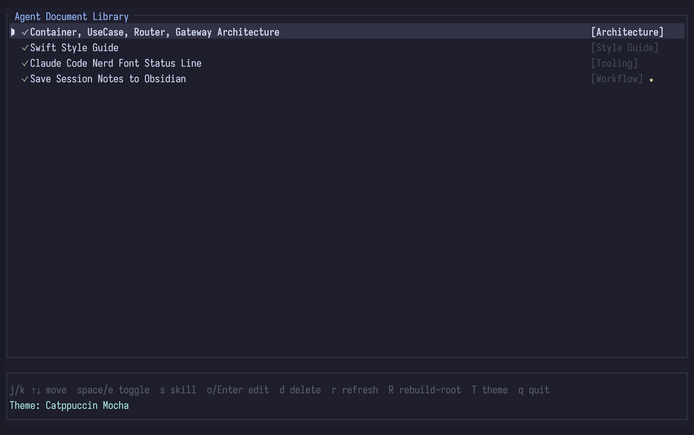

# Agent Document Library



A tool for managing and providing human-vetted software documents to AI agents. Provides an MCP server that agents query for documents, and a TUI for humans to manage the library.

I built this after being moved between 3 different AI tools at work, while I could technically implement these things in skills, it meant working out the configuration for each tool and lugging my files around all over the place. This MCP provides a centralized location for snippets, documents and style guides.

## Prompts

Ask the agent to check your library before starting work on a task:

```
Before we start, check the agent library for any relevant documents on this task type.
```

Save something useful mid-conversation:

```
Save that error handling pattern we just worked out to the agent library so we can reuse it.
```

Pull in a specific guide by name:

```
Look up the "REST API Design" document from the agent library and follow those conventions.
```

## Disclosure

This was built using Claude Code with Opus 4.7.

## How it works

Documents are Markdown files with YAML front-matter stored on disk. The MCP server exposes tools that agents use to look up and save documents. The TUI lets you browse, toggle, edit, and delete documents interactively.

Documents marked `isSkill: true` are exposed as their own callable MCP tools — the agent can invoke them directly by name rather than looking them up.

## Installation

### From source (requires Rust)

```sh
cargo install --path .
```

### With Nix

```sh
nix run git+https://codeberg.org/westongpt/agent-library
```

Or enter a dev shell:

```sh
nix develop git+https://codeberg.org/westongpt/agent-library
```

## Quick start

1. Initialize the library with seed documents and themes:

```sh
agent-library init
```

This creates `~/.config/agent-library/` (or `$XDG_CONFIG_HOME/agent-library/` on Linux, or whatever `$AGENT_LIBRARY_PATH` points to) with three example documents, a `ROOT.md` index, and four Catppuccin theme files.

2. Manage documents with the TUI:

```sh
agent-library tui
```

Start with a specific theme using `--theme`:

```sh
agent-library tui --theme "Catppuccin Latte"
```

3. Register the MCP server with Claude Code:

```sh
claude mcp add agent-library -- agent-library serve
```

## Claude Code skill: `/intake-document`

The repo ships a Claude Code slash command that turns any document into a library entry in one step.

### Install

**One-liner** (installs to `~/.claude/commands/` so it's available in every project):

```sh
curl -fsSL https://codeberg.org/westongpt/agent-library/raw/branch/main/install-skill.sh | sh
```

**From a clone:**

```sh
./install-skill.sh
```

Restart Claude Code (or run `/reload`) after installing.

### Usage

(Requires the MCP server to be registered — see [Quick start](#quick-start).)

```
/intake-document path/to/document.md
/intake-document https://example.com/some-guide
/intake-document Use dependency injection for all service constructors...
```

The skill accepts a file path, a URL, or inline text. It will:

1. Read or fetch the content.
2. Call `browse_documents` to check existing task types and prefer matching one over creating a new one.
3. Infer a concise `name` and the best-fit `task_type`.
4. Reformat the content into clean Markdown if needed, preserving well-structured documents as-is.
5. Call `save_document` and report the name, task type, and saved file path.

## Running tests

```sh
cargo test
```

## Linting

```sh
cargo clippy -- -D warnings
```
